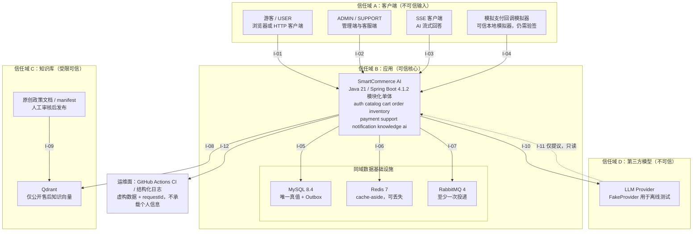
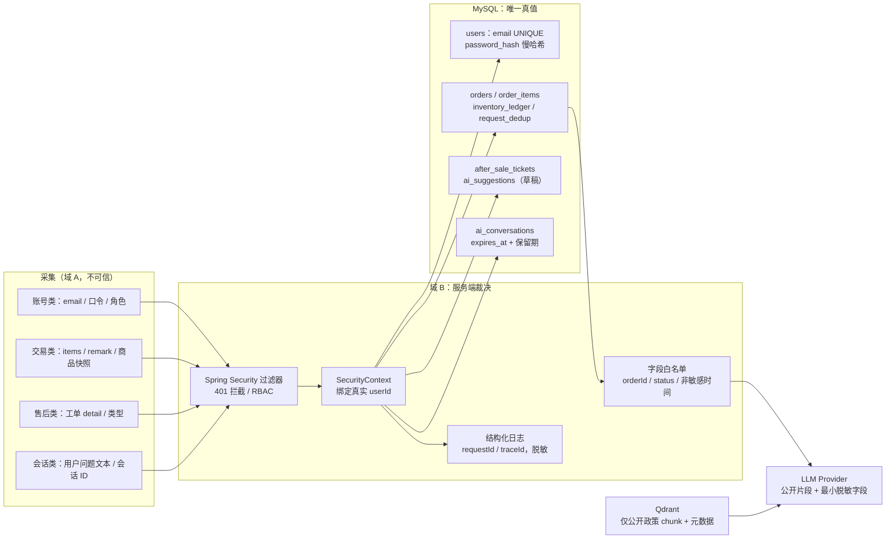

# C4 Level 1：系统上下文与个人信息流向

- 工单：SC-0102（W1，Must，1.5h）
- 状态：待验收
- 依据：`docs/plan/SmartCommerce_AI_v2_Development_Manual_238_Days.md` 第 2、3、4、5、9 章；`docs/prd/README.md` §0.1/§0.2/§0.3/§3.6/§4/§5；`docs/prd/non-goals.md`；`docs/adr/0000-technology-baseline.md`；`docs/adr/0001-mvp-scope.md`
- 关联工单：SC-0104（统一错误契约）、SC-0105（Compose 凭据）、SC-1401~1407（Outbox）、SC-2101~2207（RAG）、SC-2301~2307（Tool 授权）

## 0. 适用时点与诚实声明

本文描述的是 **W16/W19+ 的目标态契约，不是当前已实现的系统**。截至 2026-11-05，仓库只有 `SmartCommerceApplication` 启动类与一个 `contextLoads()` 冒烟测试，AI 接口、MySQL 业务表、Redis、RabbitMQ、Qdrant 均按手册分别于 W2/W13/W14/W19/W21 起逐步引入（W16 MVP 不实现 AI 接口，见 PRD §5）。本文用于冻结边界，供后续工单按编号 I-xx 引用；不得据此声称某能力已上线、已测量或已达标。

## 1. 系统定义与范围

**本系统**：SmartCommerce AI —— 一个可独立部署的 Java 21 / Spring Boot 4.1.2 模块化单体电商后端，对外提供 `/api/v1` HTTP 与 SSE 接口，覆盖认证、商品、购物车、订单、库存、模拟支付、售后工单；第二里程碑叠加 RAG 售后问答、本人订单只读工具与客服回复草稿。

**C4 Level 1 只回答**：系统边界在哪、谁使用它、与哪些外部实体交互、交换什么数据、如何认证、失败怎么办。**不画**容器层（L2）、组件层（L3）、代码层（L4）、部署拓扑、表结构 DDL 与接口 JSON Schema。

**不做**（`non-goals.md`）：真实收款/物流/退款、真实用户数据导入、微服务拆分、模型训练、W27 前的 MCP 试验、完整运营后台 UI。

## 2. 信任域划分

| 域 | 名称 | 可信级别 | 成员 | 判定理由 |
|---|---|---|---|---|
| A | 客户端域 | 不可信输入 | 游客、USER、ADMIN、SUPPORT 的 HTTP/SSE 客户端；模拟支付回调模拟器 | 网络边界之外，一切输入必须校验；回调模拟器虽为「可信本地模拟器」，仍需验签 |
| B | 应用域 | 可信核心 | Spring Boot 模块化单体 + MySQL 8.4 + Redis 7 + RabbitMQ 4 | 同一部署单元与内网；MySQL 是唯一真值，Redis 只做缓存，MQ 只做事件传递 |
| C | 知识库域 | 受限可信 | Qdrant + 原创政策文档/manifest | 载体可控，但**文档文字是低可信输入**；只存审核通过且当前有效的公开售后知识 |
| D | 第三方模型域 | 不可信 | LLM Provider（测试用 FakeProvider） | 跨组织/公网边界，返回文本不可信，受 API Key、配额、超时约束 |
| — | 运维面 | 内部 | GitHub Actions CI、结构化日志、Docker Compose | 只处理虚构数据与脱敏链路信息，不承载用户个人信息 |

**核心红线**：模型（域 D）不在订单状态机的任何一条边上。价格、库存、订单状态、订单归属、幂等判定、售后状态只能由域 B 的 Java 代码依 MySQL 真值裁决（PRD §4）。客户端与 AI 提交的一切内容都只是「申请」。

## 3. C4 上下文图



> 图例：实线 = 实际调用；虚线 = 模型的**不可信输出**（工具调用提议 / 文本），必须在服务端校验后才可生效。每条边的编号对应第 5 节表格中的同一行。

## 4. 个人信息流向图



> 本图只画**个人信息实际流向**。模型返回（I-11）不是个人信息回流路径，而是不可信的工具调用提议与文本，已在 §3 用虚线表达，并由 §5 I-11 的服务端校验与字段白名单约束。

**数据分类与落点**

| 类别 | 具体数据 | 落点 | 保护措施 |
|---|---|---|---|
| 账号类 | email、口令（仅存 `password_hash`）、role | `users` / `roles` / `user_roles` | BCrypt/Argon2 慢哈希；错误响应不泄露账号是否存在之外的信息 |
| 交易类 | items、`remark`、价格/商品快照、金额、库存流水 | `orders` / `order_items` / `inventory_ledger` / `request_dedup` | 服务端算价；`DECIMAL(18,2)`；`Idempotency-Key` 三元组唯一；对象级归属校验 |
| 售后类 | 工单 `detail`、`type`、`active_order_key` | `after_sale_tickets` | SUPPORT/ADMIN 审核；USER 不可自行完结 |
| 会话类 | AI 会话、用户问题文本、AI 草稿 | `ai_conversations` / `ai_suggestions` | `expires_at` 保留期；草稿经人工审核才成为正式回复 |
| 链路类 | `requestId` / `traceId`、`audit_log` | 结构化日志、审计表 | 不记口令、Bearer Token、完整聊天原文；越权与「不存在」返回同构 404 |
| 演示类 | 虚构静态收货信息 | 接口 DTO（不建地址模块） | 非用户输入、非真实个人信息（`non-goals.md` §2） |

**明令禁止的流向（红线）**

1. 订单私有数据 → Qdrant / 公共向量库（手册 2.1、PRD §5）。
2. 收货地址、手机号、支付凭据、金额明细 → 模型 prompt / 工具输出（PRD §3.6 白名单）。
3. `userId` → 由模型输出或用户文本决定；必须取自 `SecurityContext`（手册 5.4）。
4. 模型输出 → 订单/库存/售后状态的写操作；AI 无写权限（PRD §4、§5）。
5. 口令 / Token / 完整聊天原文 → 普通运维日志（手册 2.4）。
6. 真实用户数据 → 评测集、知识库或外部 AI（AGENTS.md §3.6、`non-goals.md` §1）。

**边界诚实说明**：用户自由输入的问题文本可能夹带个人信息，本项目采取输入侧提示、日志脱敏、评测集全程虚构数据的措施，**不承诺对自由文本做到完全清除**；第三方模型的出域内容以第 5 节 I-10 的载荷清单为准。

## 5. 跨系统调用清单（验收核心）

> 每一行即图上一条边；「数据类型 / 认证方式 / 失败策略」三列为工单 SC-0102 的强制验收项。F-xx 编号对应手册第 9 章故障演练清单。

| 编号 | 方向 | 调用内容 | 数据类型 | 认证方式 | 失败策略 |
|---|---|---|---|---|---|
| I-01 | A → B | 用户端 `/api/v1` 常规接口（注册、登录、商品、购物车、下单、取消、售后、订单查询） | JSON 请求/响应 DTO；`Idempotency-Key`；`skuId`/`orderId` 为字符串业务码；金额字符串 `DECIMAL(18,2)` | Bearer Token + Spring Security 过滤器；身份取自 `SecurityContext`，忽略请求体 userId；角色 USER | 401 未认证 / 403 越权 / 404 不存在（越权同构）/ 409 冲突（库存、幂等）/ 400 `PARAM_INVALID` / 429 限流 / 503 锁等待可重试 / 500 统一错误结构 `{code, message, requestId, details?}` 且不暴露堆栈；由 SC-0104 落地 |
| I-02 | A → B | 管理端与客服端接口（商品管理、工单审核、AI 草稿采纳） | JSON DTO；工单状态迁移指令；草稿文本 | Bearer Token + RBAC（ADMIN / SUPPORT）；SUPPORT 仅能访问**关联了售后工单**的订单，对象级授权 | 403 无权限；404 越权；工单状态不因未授权请求改变；审核操作写 `audit_log` |
| I-03 | B → A | `POST /api/v1/ai/chat/stream` SSE 流式回答（W19+ 目标态） | `text/event-stream` 增量文本片段 + 引用文档 ID | 同 I-01；按会话与用户限流；测试用 FakeProvider 不消耗真实额度 | 断连清理资源；超时/429/5xx 有限重试后降级为静态 FAQ 或转人工工单；不影响任何订单接口（F-08） |
| I-04 | A → B | `POST /api/v1/mock-payments/callback` 模拟支付回调 | 支付号、订单号、状态、`callback_seq` 单调递增序号、本地演示签名 | **本地演示签名验签**，密钥仅存 `.env`；**不走 `request_dedup`**（调用方无用户身份，PRD §0.2） | 验签失败直接拒绝并记日志、不变更任何状态；重复回调幂等、不重复发事件；乱序旧 `callback_seq` 拒绝、不覆盖新状态；与取消竞争由条件状态更新裁决，只产生一个合法终态（PRD EX-O9 / EX-O10、F-04） |
| I-05 | B → INFRA | 业务读写 MySQL（唯一真值） | 订单/库存/幂等/售后/Outbox 表；原生 MyBatis `#{}` 绑定；`DECIMAL(18,2)`、UTC 时间 | 应用账号来自 `.env`，最小权限仅 `smartcommerce.*`；端口仅绑 `127.0.0.1:3306` | 连接/写入失败 → 本地事务整体回滚，不留「扣了库存没订单」；schema 变更只走新 Flyway 迁移，禁改已部署 V1/V2；对外 500/503，日志不含敏感参数值（F-02） |
| I-06 | B → INFRA | Redis 商品公开信息缓存（W13+ 目标态） | 商品详情 DTO、空值标记；带 TTL | 仅绑定 `127.0.0.1:6379`，不对外暴露；无业务账号体系 | Cache-Aside；超时/连接失败降级直读 MySQL，**不改变交易结果**；订单金额与库存判定绝不依赖缓存值（F-07、PRD INV-Q2） |
| I-07 | B → INFRA | Outbox 事件投递 RabbitMQ（W14+ 目标态） | JSON payload + `event_id` / `event_type` / `retry_count`；**只放事件标识，不放用户隐私** | 账号凭据来自 `.env`；管理台端口绑 `127.0.0.1` | 业务与 `outbox_events` 同事务写入；Dispatcher 重试补发；至少一次投递 + Inbox `(consumer_name, event_id)` 唯一键幂等；永久失败进 DLQ/报警；**不承诺 Exactly Once 或绝不丢失**（F-05、F-06） |
| I-08 | B → C | 知识检索与索引维护（W21+ 目标态） | 上行：chunk 文本 + embedding + `docId/version/status/effectiveAt/source/chunkId`；下行：Top-K 片段 | 内网端口 `127.0.0.1:6333/6334`，不暴露公网；无用户身份参与 | 检索按「审核通过且当前有效」做元数据过滤；旧政策撤回后删除/屏蔽旧向量；服务不可用 → 静态 FAQ 或转人工；**回答引用由服务端验证，不信任模型自造来源** |
| I-09 | C → C | 政策文档发布流程 | 原创虚拟售后政策 / 演示 FAQ + manifest | 人工审核后标记公开（非自动信任） | 文档内含指令性文字时**只当数据，不当命令**；检索注入由 F-10 攻击样本覆盖；不上传真实企业内部文档 |
| I-10 | B → D | 模型推理请求（W19+ 目标态） | 系统提示词 + 用户问题文本 + **公开知识片段** + 工具定义 + 白名单最小订单字段（`orderId/status/非敏感时间`）；**不含订单私有数据、口令、支付凭据** | API Key 仅存 `.env`（已被 `.gitignore` 忽略），不进 Git/日志/前端；Provider 经 AiGateway 适配器隔离 | 超时、有限重试、按用户/会话的 token 与成本预算；429/5xx → 降级静态 FAQ / 转人工，普通订单接口不受影响；高频请求 429（F-08、F-11）；CI 与本地默认 FakeProvider，无真实 Key 也能跑测试 |
| I-11 | D → B | 模型返回：自然语言文本 + **工具调用提议** | 非结构化文本、拟调用的 `getMyOrderStatus(orderId)` 参数、引用 ID | **不受信任**：先做 schema 校验、输出策略与引用验证；`userId` 由运行时从 `SecurityContext` 绑定，绝不采用模型给出的身份 | 越权查单在工具层硬拦截（403/404 或拒答，F-09）；不符合 JSON Schema 的字段拒绝或修复为受控草稿，绝不落到数据库写操作；提示注入/敏感信息泄露按 2026 OWASP GenAI Top 10 评测；安全关键用例未 100% 通过则不开放 Tool |
| I-12 | B → 运维面 | 结构化日志、链路追踪、CI 测试 | `requestId` / `traceId`、错误码、脱敏业务标识、测试结果 | CI 使用 `workflow_dispatch` / push / PR 触发；无生产凭据 | 日志不记口令、Bearer Token、完整聊天原文；日志写入失败不影响交易；CI 只用虚构数据与 FakeProvider，不接真实模型、不消耗额度；`./mvnw -B -ntp test` 为基线门禁 |

## 6. 失败与降级口径汇总

- AI 链路（I-03/I-08/I-10/I-11）全部是**旁路**：任何一环失败，商品、购物车、下单、库存、支付、售后接口必须照常可用。
- 缓存（I-06）与消息（I-07）失败不得改变交易正确性；MySQL（I-05）是唯一真值。
- 统一错误契约与 `requestId` 由 SC-0104 落地；本文只冻结「失败时对外表现与降级路径」，不定义具体异常类。
- 演练编号映射：F-04 回调竞争、F-05 MQ 断网、F-06 重复消费、F-07 Redis 故障、F-08 Provider 故障、F-09 越权查单、F-10 检索注入、F-11 成本攻击、F-12 迁移不兼容。均为**本地故障演练**，未发生线上事故、无压测数据，不宣称性能结论。

## 7. 非目标

- 不画 C4 L2 容器图 / L3 组件图 / L4 代码图，不画部署拓扑、网络 ACL 细节。
- 不定义接口 JSON Schema、表 DDL、错误码全集（分别归 SC-0304、SC-0203 起各迁移、SC-0104）。
- 不写任何真实口令、token 或真实用户数据；不描述尚未实现的 AI 能力为「已上线」。
- 不承诺消息 Exactly Once、不承诺性能/RAG 质量/成本指标（无测量数据，见 AGENTS.md §8）。

## 8. 验收对照（SC-0102）

| 工单验收项 | 本文落点 | 自查结果 |
|---|---|---|
| C4 上下文图 | §3，含系统与外部实体、四个信任域 | 已覆盖 |
| 个人信息流向图 | §4，含 6 类数据、落点、6 条禁止流向 | 已覆盖 |
| 区分客户端 / 后台 / 第三方模型 / 知识库信任边界 | §2 域 A/B/C/D + §3 四个 subgraph | 已覆盖 |
| 每条跨系统调用都有数据类型 | §5「数据类型」列，I-01~I-12 全非空 | 已覆盖 |
| 每条跨系统调用都有认证方式 | §5「认证方式」列，I-01~I-12 全非空 | 已覆盖 |
| 每条跨系统调用都有失败策略 | §5「失败策略」列，I-01~I-12 全非空 | 已覆盖 |
| 不能把模型设为订单状态真值 | §2 核心红线、§4 红线 4、§3 虚线 I-11 标注「仅提议，只读」 | 已覆盖 |

**可复现验证命令**（在仓库根目录执行，无需额外脚本文件）：

```bash
./mvnw -B -ntp test
git diff --check
grep -c '^| I-' docs/architecture/context.md    # 期望输出 12
```

## 9. 变更记录

| 日期 | 变更 | 依据 |
|---|---|---|
| 2026-11-05 | 初版：冻结 W16/W19+ 目标态信任边界、12 条跨系统调用、个人信息流向与红线 | SC-0102；手册第 2/3/4/5/9 章；PRD 已定稿版本；ADR-0000 / ADR-0001 |
